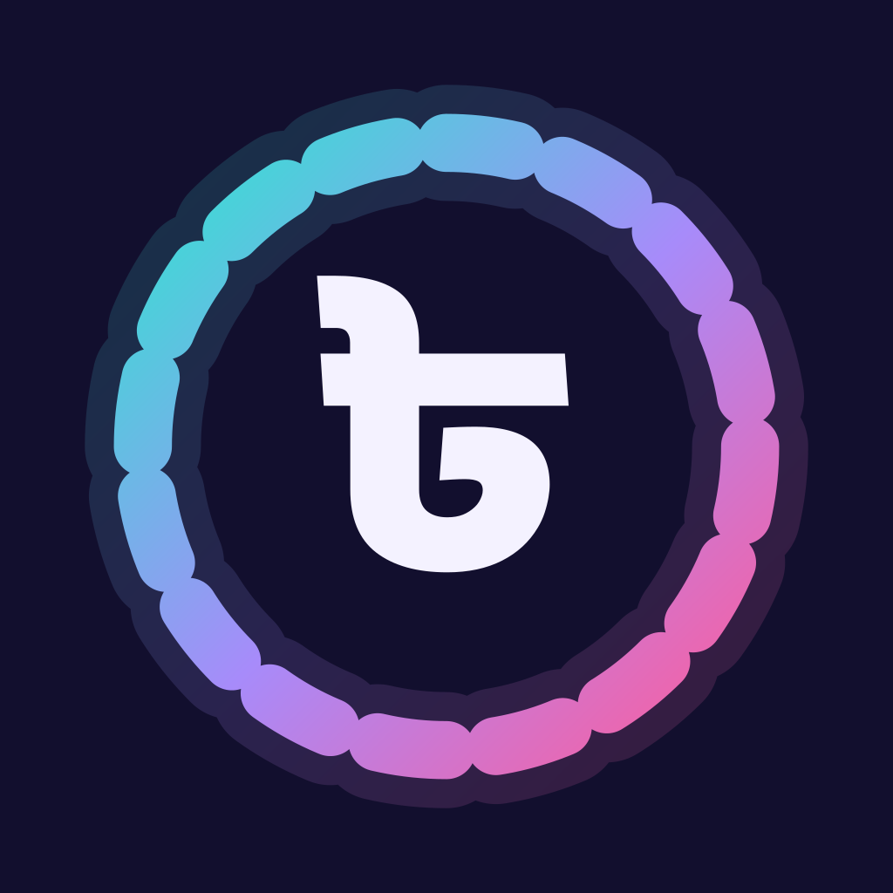
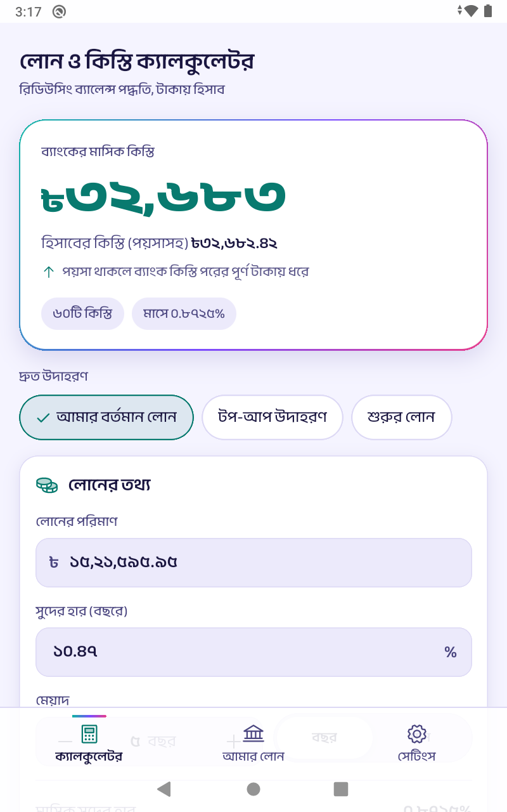
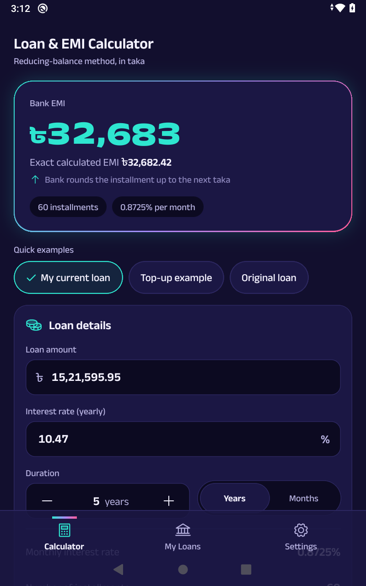
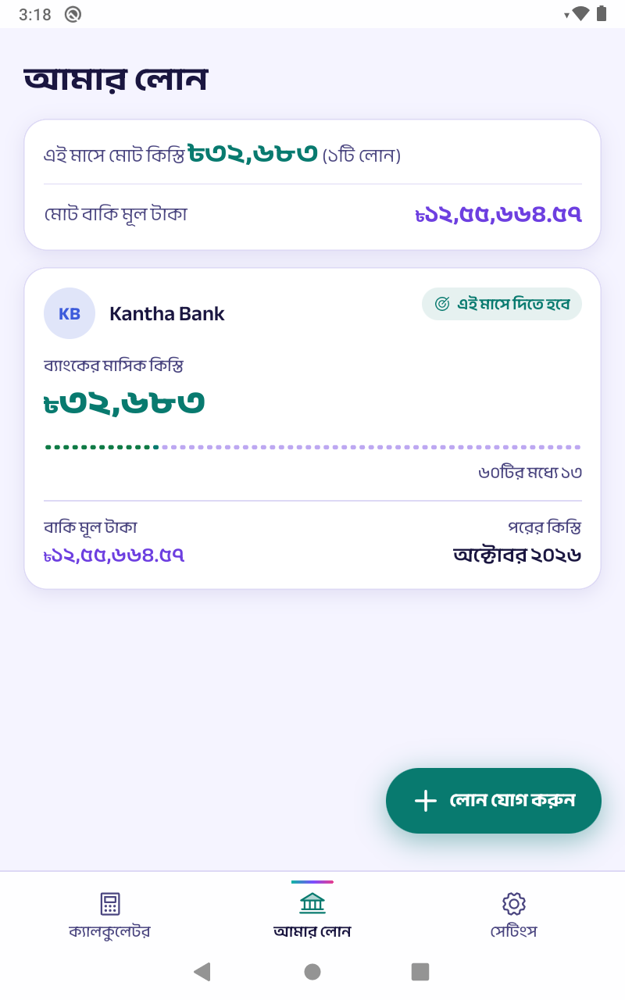
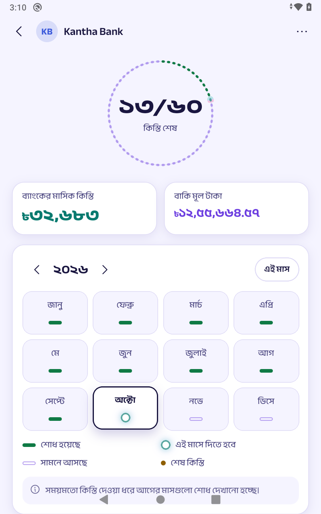

<div align="center">



# Kisti · কিস্তি

**Loan & EMI calculator and installment tracker for Bangladesh.**
Offline, bilingual (বাংলা / English), and accurate to the paisa.

[](.github/workflows/ci.yml)
[](LICENSE)


</div>

---

Kisti (কিস্তি, "installment") is the word Bangladeshi borrowers use for their EMI. The app answers the two questions every borrower has:

1. **"What will the bank actually charge me each month?"** It shows the bank EMI rounded up to the next taka, exactly the way banks do it, plus the full schedule and the formula with your own numbers.
2. **"Where am I on my loan this month?"** Save a real loan, pick any month on a calendar, and see that month's installment, the interest and principal parts, what you have paid, and what is left.

There is no login, no server, no ads and no analytics. Everything stays on the phone, and the release build has no network permission.

<p align="center">
  
  
  
  
</p>

## Features

**EMI calculator**
- Bank EMI rounded **up** to the next taka (never to the nearest), with the exact EMI next to it.
- Deductions at disbursement (old-loan settlement, insurance, bank fees, other) itemised against the approved amount, with the cash you actually receive. A negative result is shown, with a warning, never clamped to zero.
- Repayment summary built from the real schedule, so the total includes the smaller last installment. The bank-style "EMI × n" figure appears as a caption so you can match it against your bank's paperwork.
- "How it's calculated": the reducing-balance formula with your numbers substituted, step by step.
- Full month-by-month schedule. Three one-tap presets, and the last inputs are restored on the next launch.

**My Loans**
- Save loans with bank name, nickname, amount, rate, duration, first installment month, deductions and a card colour.
- A stitch ring shows progress at a glance; a month calendar marks every installment as paid, due, upcoming or final.
- Tap any month for its installment, interest and principal split, remaining principal, paid so far and still to pay.
- Edit, delete with a 5-second Undo, and a monthly summary across all running loans.

**Built for people, not just numbers**
- বাংলা and English, switched instantly, with Bengali digits and lakh/crore grouping (৳১৫,২১,৫৯৫.৯৫).
- Light, dark and follow-phone themes, designed around the "Neon Kantha" look: rickshaw-art colours that each carry a fixed meaning (teal for installments, violet for principal, marigold for interest, pink for deductions, green for cash).
- Subtle motion, sound and haptics, each of which can be turned off; reduce-motion is respected.
- Screen-reader labels spell out money ("32,683 taka" / "৩২,৬৮৩ টাকা"), every touch target is at least 48 pt, and no status relies on colour alone.

## How the numbers are calculated

All money in the schedule is kept in **integer paisa**, so totals are exact and the final balance is always zero.

```text
r        = yearly rate ÷ 12 ÷ 100
exactEmi = P × r × (1 + r)ⁿ ÷ ((1 + r)ⁿ − 1)      (P ÷ n when r = 0)
bankEmi  = ceil(exactEmi − 0.000001)               rounds up; the tolerance absorbs float noise

each month: interest = round(balance × r) to the paisa
            payment  = bankEmi, or the remaining balance + interest in the last month
```

Because the bank rounds every installment up, the last installment is a little smaller, and a loan can finish early (for example ৳1,000 at 12% over 30 years finishes in 242 installments). The engine reproduces the spec's two reference installments exactly:

| Loan | Bank EMI | Last installment | Total repayment |
|---|---|---|---|
| ৳15,21,595.95 at 10.47% for 60 months | **৳32,683** | ৳32,637.72 | ৳19,60,934.72 |
| ৳12,00,000 at 12% for 60 months | **৳26,694** | ৳26,639.88 | ৳16,01,585.88 |

The calculation lives in [`src/core`](src/core) as pure TypeScript with no React Native imports, and is covered by tests for every value in the specification (§5.12 and §13.1 of [`docs/SPEC.md`](docs/SPEC.md)).

> Kisti gives estimates. Banks may use daily interest, different payment dates or their own rounding. Confirm final figures with your bank. Kisti does not offer loans.

## Tech stack

| Area | Choice |
|---|---|
| App | Bare React Native **0.88** (New Architecture, Hermes), TypeScript strict |
| Navigation | React Navigation 7 (native stack + bottom tabs, custom faux-glass tab bar) |
| Animation | Reanimated 4 + Worklets (UI-thread only) |
| Graphics & icons | react-native-svg, phosphor-react-native (imported per icon) |
| State & storage | zustand with `persist`, backed by react-native-mmkv 4 (Nitro) |
| Feedback | react-native-sound (generated WAVs), react-native-haptic-feedback |
| Splash | react-native-bootsplash |
| i18n & formatting | Small typed dictionaries and hand-written formatters (no `Intl`, no i18n or date library) |
| Fonts | Anek Bangla / Anek Latin static instances (SIL OFL), subset to 1.9 MB |
| Tests | Jest + React Native Testing Library |

Every dependency is free, open source, maintained, and compatible with the New Architecture and Android's 16 KB page size. There are no analytics, ads, crash reporters, remote config or network calls.

## Project structure

```text
src/
  app/          App root, navigation, tab bar, version
  core/         Pure calculation engine: loan maths, months, stitch geometry (no RN imports)
  i18n/         en.ts / bn.ts dictionaries (key parity enforced by types), formatters
  state/        zustand store, MMKV adapter, migrations and corrupt-data recovery, selectors
  theme/        Design tokens (dark + light), fonts, type scale, ThemeProvider
  feedback/     Motion tokens, sound and haptics (each respects its setting)
  components/   primitives, money (hero card, bars, stitch ring), calendar, schedule, loans, overlays
  screens/      Calculator, My Loans, Add/Edit loan, Loan detail, Full schedule, Settings, Language
  assets/       fonts/, sounds/
scripts/        Reproducible asset generators (sounds, icons, outlined brand SVGs, font instances)
assets/brand/   Outlined app-icon and splash SVGs
docs/           SPEC.md (product, design and build spec) and the design handoff bundle
```

## Getting started

**Prerequisites:** Node.js ≥ 22.11, JDK 17, Android Studio with SDK Platform 36/37 and NDK 27, and for iOS a Mac with Xcode 16+ and CocoaPods. Follow the official [React Native environment setup](https://reactnative.dev/docs/set-up-your-environment) if this is your first React Native project.

```bash
git clone https://github.com/nsrobin/kisti.git
cd kisti
npm ci

# Android (emulator running or device connected)
npm run android

# iOS (macOS only)
cd ios && bundle install && bundle exec pod install && cd ..
npm run ios
```

### Useful scripts

| Command | What it does |
|---|---|
| `npm start` | Start Metro |
| `npm run check` | Lint, type-check and run all tests |
| `npm run test:coverage` | Tests with coverage (core logic is at 100% line coverage) |
| `npm run build:android` | Release AAB for Google Play |
| `npm run build:android:apk` | Release APKs, one per ABI |
| `npm run generate:sounds` | Regenerate the five UI sounds (Node, no dependencies) |
| `npm run generate:icons` | Re-render Android and iOS app icons from `assets/brand` |
| `npm run link:assets` | Re-link fonts and sounds into the native projects |

## Release builds

### Android

1. Create an upload key once: `keytool -genkeypair -v -keystore kisti-upload.jks -alias kisti -keyalg RSA -keysize 2048 -validity 10000`
2. Add the key to `~/.gradle/gradle.properties` (never to the repository):

   ```properties
   KISTI_UPLOAD_STORE_FILE=/absolute/path/to/kisti-upload.jks
   KISTI_UPLOAD_STORE_PASSWORD=…
   KISTI_UPLOAD_KEY_ALIAS=kisti
   KISTI_UPLOAD_KEY_PASSWORD=…
   ```

3. `npm run build:android` produces `android/app/build/outputs/bundle/release/app-release.aab`.

Without those properties, release builds are signed with the debug key so they can still be installed locally. Release builds enable R8 and resource shrinking, strip `console.*`, and ship without the `INTERNET` permission (it is declared only in the debug manifest for Metro). Check 16 KB alignment with `zipalign -c -P 16 -v 4 <apk>`.

### iOS

Open `ios/Kisti.xcworkspace` in Xcode, set your team and bundle identifier under *Signing & Capabilities*, then choose **Product › Archive**. The launcher name is "Kisti", or "কিস্তি" on phones set to Bengali.

## Specification and design

The product, design and build specification is in [`docs/SPEC.md`](docs/SPEC.md), and the design handoff (tokens, component inventory, screens, copy and reference engine) is in [`docs/design-handoff`](docs/design-handoff). Where this implementation intentionally differs from them, it is listed below.

<details>
<summary><strong>Implementation notes and deviations</strong></summary>

- **Handoff deviations adopted as designed:** light-mode `text.muted` is `#625E8F` for contrast, money colours never sit inside inputs, five dedicated loan-card accent colours (stored as `nil | shimul | orchid | kadam | akash` rather than money-colour names, so money colours keep a single meaning), linear stitch progress switches to year stitches above 60 installments, the hero figure shrinks from 48 to 40 pt above 8 glyphs, and the loan overview lists only non-zero deductions.
- **Fonts:** to stay inside the 2 MB budget, the normal-width ExtraBold instance is not shipped; weight 800 uses SemiExpanded ExtraBold. Anek Latin has no "৳", so the sign is always set in Anek Bangla.
- **Gestures:** year swiping and sheet dragging use React Native's built-in `PanResponder`, so `react-native-gesture-handler` (a native dependency) is not needed.
- **Gradients and shadows** use React Native 0.88's built-in `backgroundImage` and `boxShadow` styles; no gradient library.
- **Validation:** a negative deduction uses the "Enter a valid number" message (§5.11 has no dedicated text). Copy the spec did not cover (for example "Month 1", "5 years", accessibility labels) was added to both dictionaries; see the end of `src/i18n/en.ts`.
- **Android navigation bar:** with edge-to-edge (default in React Native 0.88) the system bars are transparent over the app background, so no separate navigation-bar colour is set.
- **Splash:** one Indigo Night splash for both themes; separate dark/light splash assets would need a paid generator licence.
- **iOS** was configured but could not be built in the Linux environment this was developed in; build and smoke-test it on a Mac before release.

</details>

## Privacy

Kisti collects no data. Loans and settings are stored only on the device (MMKV) and are never transmitted. For store listings: Play Data safety "No data collected or shared"; App Store privacy label "Data Not Collected".

## Contributing

This repository is published for reference and is **read-only**: pull requests are not accepted. You are welcome to clone it, fork it and build on it under the terms of the MIT license.

## License

Code: [MIT](LICENSE) © 2026 Md. Nazmus Shakib.
Fonts: Anek Bangla and Anek Latin are licensed under the [SIL Open Font License 1.1](src/assets/fonts/OFL.txt). Icons: [Phosphor](https://phosphoricons.com) (MIT). All bank names in the designs and tests are fictional.
